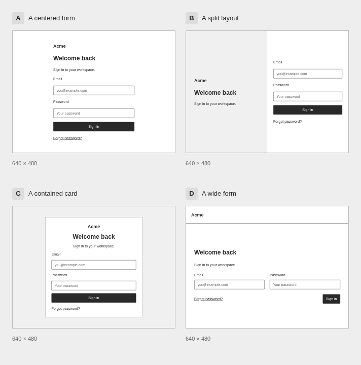
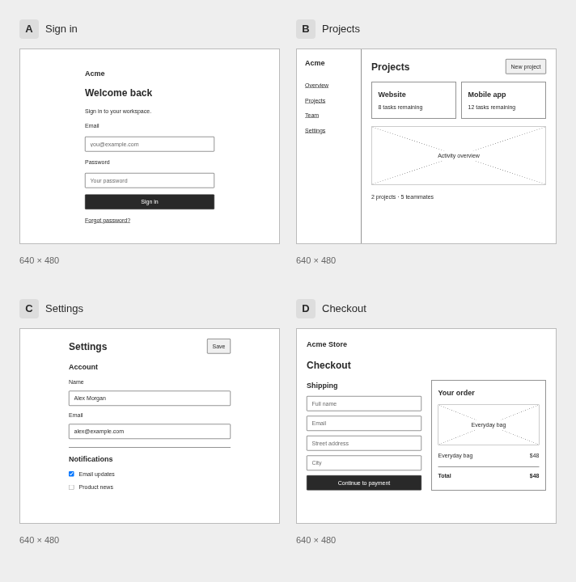

<div align="center">

# nofi

**Let your agent sketch before it builds.**

Pug + Tailwind → low-fidelity mockups → choose a layout → build it.

[Agent skill](skills/nofi/SKILL.md) · [Source format](docs/format.md) · [Themes](docs/themes.md) · [Playground](https://lukeda.github.io/nofi/) · [GitHub](https://github.com/lukeda/nofi)

</div>

**Choose a design for one screen.** Four sign-in layouts with identical content: Acme, welcome text, email, password, Sign in, and Forgot password. Compare a centered form, split layout, contained card, and wide form.



[Open HTML](docs/assets/layout-options.html) · [Board source](examples/login.board.yaml)

**Wireframe several screens.** Explore sign-in, projects, settings, and checkout together to establish the structure of an app.



[Open HTML](docs/assets/screen-wireframes.html) · [Board source](examples/screens.board.yaml)

## Made for agents

Ask your agent:

> Use nofi to sketch six different layouts for a project dashboard. Render a comparison board and let me choose before implementing it.

The single **nofi** skill covers writing the mockups, rendering them, and retaining the selected source for implementation. Layouts use familiar Pug and Tailwind. Themes provide deliberately basic buttons, inputs, typography, and image placeholders.

```pug
main.flex.flex-col.gap-4.p-8
  h1 Welcome aboard
  p Make room for your next idea.
  input(placeholder="Email address")
  button Create account
```

## Give your agent nofi

This is an early prototype. The GitHub and playground links will become available after the first push and Pages deployment. The npm package `@lukeda/nofi` is prepared but not yet published.

After the first push, install the skill:

```sh
npx skills add lukeda/nofi --skill nofi
```

Before the first push, use `npx skills add /path/to/nofi --skill nofi` instead.

The skill includes renderer setup instructions. It can create temporary `.pug` files, render a board, and keep the sources available while you choose. Skill installation and renderer installation are currently separate; after npm publication, agents can use `npx --yes @lukeda/nofi` without a permanent install. The CLI command and skill stay named `nofi`.

[Agent setup](docs/agents.md) · [Local development](docs/development.md) · [Contributing](CONTRIBUTING.md)

## Compare options

A board can give reusable Pug files names and shared settings:

```yaml
viewport: [640, 480]
theme: wireframe
columns: 2
items:
  - file: sidebar.pug
    name: Sidebar navigation
  - file: topbar.pug
    name: Top navigation
```

The CLI accepts a board file or YAML on stdin through a heredoc. HTML is standalone; PNG export uses Chromium. See the [board commands](docs/format.md#boards).

The examples include six dashboard layouts, four login layouts, two settings layouts, and two checkout flows. The browser playground includes all of them, with editable source, viewport controls, and themes. It is a static site prepared for [GitHub Pages](docs/development.md#github-pages).

## Why this approach?

- **Familiar source:** declarative Pug and Tailwind utilities, without a new layout language.
- **Focus on structure:** compare navigation, hierarchy, and density before polishing visuals.
- **Theme-aware:** semantic colour utilities adapt the same source to different themes.
- **Portable handoff:** retain the selected Pug alongside the implementation brief.

[Library API](docs/api.md) · [Theme authoring](docs/themes.md)

Inspired by [PlantUML Salt](https://plantuml.com/salt), [Balsamiq](https://balsamiq.com/), and [Mermaid](https://mermaid.js.org/).

[MIT licensed](LICENSE).
